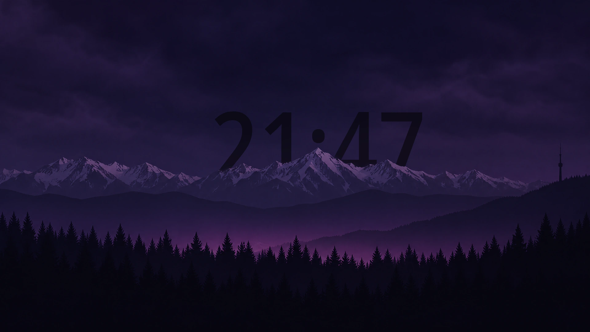
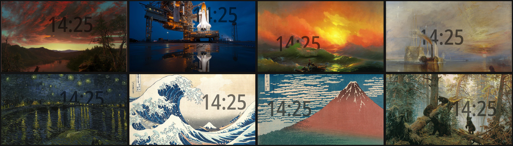

# depth-clock

A desktop clock set into the wallpaper, behind its foreground: the mountains,
the city, the person in the picture. It works with any wallpaper.



Linux, on Wayland compositors with wlr-layer-shell: Hyprland, Sway, niri, river,
KDE. Not GNOME, not X11. The clock is drawn by [Quickshell](https://quickshell.org);
the analysis is a separate CLI.

## How it works

The CLI in `bin/depth-clock` looks at the wallpaper once and caches what it found:

- **Layers.** A depth model (Depth Anything V2 Small) estimates how far each
  pixel is. Cut at several depths, each cut is a layer: what is nearer stands
  in front of the clock. Only parts that touch the bottom edge count, so logos,
  moons and clouds never do.
- **Places.** For every layer it tries positions and scores them: about a third
  of the digits covered, every digit readable, a visible ridge, a calm and even
  background behind the visible part. A second model (ISNet) marks the main
  subject so the digits stay off it. With no good place, the clock stands alone
  on the calmest spot.
- **Color.** Follows the background behind each part of the digits: a dark
  silhouette on light skies, a lifted tone on dark ones.

It writes `~/.local/state/depth-clock/current.json`. The Quickshell side draws
the digits with that color, then the wallpaper again on top of them through the
layer's mask. A new wallpaper takes about half a minute on a CPU, and the
clock appears once it's done. After that it's cached.



## Requirements

- [uv](https://docs.astral.sh/uv/). On the first run it builds a Python
  environment in `~/.local/share/depth-clock/venv` with numpy, Pillow, SciPy
  and ONNX Runtime.
- Quickshell 0.3 or newer, with Qt 6.
- fontconfig. The digits use the system's default serif font unless the
  config names another.
- About 270 MB in `~/.cache/depth-clock`: the two models are downloaded on the
  first analysis, from Hugging Face and GitHub, and checked by SHA-256. Nothing
  else leaves your machine.

## Install

Clone the repository, then run the clock with Quickshell:

```sh
cd depth-clock
bin/depth-clock wallpaper   # check that it finds your wallpaper
qs -p qml                   # run the clock; it analyzes the wallpaper itself
```

Start `qs -p /path/to/depth-clock/qml` with your session, for example with
`exec-once` in Hyprland or `spawn-at-startup` in niri. For the commands below,
link the CLI into your PATH: `ln -s "$PWD/bin/depth-clock" ~/.local/bin/`.

### Omarchy

The repository is also an Omarchy shell plugin. It follows the theme's
wallpaper with no config:

```sh
omarchy plugin add <repository URL> --enable
```

## Remove

Stop the `qs` process or remove the plugin (`omarchy plugin remove depth-clock`),
delete the checkout and the link in your PATH, then the data:

```sh
rm -rf ~/.cache/depth-clock ~/.local/share/depth-clock ~/.local/state/depth-clock ~/.config/depth-clock
```

## Configure

`~/.config/depth-clock/config.json`, every field optional:

```json
{
  "wallpaper": "~/.local/state/wallpaper/current",
  "font": "Noto Sans Condensed Medium"
}
```

- **wallpaper.** An image, or a symlink that your wallpaper setter keeps
  pointing at the current one. Without it, depth-clock takes Omarchy's current
  background, then asks swww.
  `DEPTH_CLOCK_WALLPAPER` in the environment and `--wallpaper` on the
  command line take precedence. `depth-clock wallpaper`
  prints what it follows.
- **font.** `serif` by default: whatever serif font the system maps that name
  to. Also takes `sans-serif`, `monospace`, or any installed font by its full
  name (`fc-list : fullname`). Tall, narrow faces such as a condensed sans read
  best behind a ridge. A different font has different shapes, so it gets its
  own analysis.

The clock looks for a new wallpaper every 30 seconds.

A hand-made mask beats the depth model: put `<wallpaper file name>.png` in
`~/.config/depth-clock/masks/`, white, opaque over what stands in front.

## Move the clock

Double-click the clock on the desktop, or run `depth-clock edit`. The editor
opens over the windows: on the focused screen under Hyprland, on the first one
elsewhere. Drag the clock with the mouse. It snaps to the screen center, thirds,
edges and a small margin from them, puts the colon over a peak, stands the
digits on the ridge or sinks a third of them behind it. Hold Shift to drag freely.

| Key | Action |
|---|---|
| corner handles, wheel, + and − | size |
| arrows, Shift+arrows | nudge by 1 or 10 px |
| L, Shift+L | what stands in front: next or previous layer, 0 is nothing |
| M | show the mask: what stands in front, tinted red |
| D | color: auto, dark, light |
| N, Shift+N | next or previous place the analysis found |
| R | back to the best place found |
| Enter | save |
| Esc | cancel |

Placements are kept per wallpaper in `~/.config/depth-clock/placements.json`.
The same is available without the mouse:

```sh
depth-clock next              # cycle through the places found
depth-clock layer next        # change what stands in front
depth-clock set --cx 0.5 --baseline 0.4 --size 0.25 --mode light
depth-clock reset             # forget the hand placement
depth-clock status
depth-clock preview --size 2560x1440 -o out.png  # render it offline
```

## Limits

- The wallpaper must fill the screen, scaled to cover and cropped at the
  center. Fit, tile and per-screen wallpapers will not line up.
- The analysis assumes 16:9 screens. On other shapes, a wallpaper with a very
  different aspect ratio can shift the mask.
- Busy paintings with no calm spot, and pictures filled by one subject, are the
  hard cases. The editor covers what the analysis gets wrong.

## Development

```sh
uv run pytest                     # analysis, on synthetic pictures
node --test tests/snap.test.mjs   # editor snapping
```

| Path | What |
|---|---|
| `src/depth_clock/` | the CLI: models, analysis, wallpaper lookup, cache, placements |
| `qml/` | `shell.qml` to run alone, `Clock.qml` (one window per screen), `ClockScene.qml` (drawing), `Editor.qml`, `snap.js` |
| `manifest.json` | the shell plugin manifest |
| `research/` | how the approach was chosen, with the prototype and the first heuristic |

## Credits

- [Depth Anything V2](https://github.com/DepthAnything/Depth-Anything-V2) Small, Apache-2.0.
- [ISNet](https://github.com/xuebinqin/DIS), Apache-2.0, in the ONNX export from [rembg](https://github.com/danielgatis/rembg).
- Images in `docs/` are public domain paintings and photos, listed in
  [docs/CREDITS.md](docs/CREDITS.md).

MIT license.
