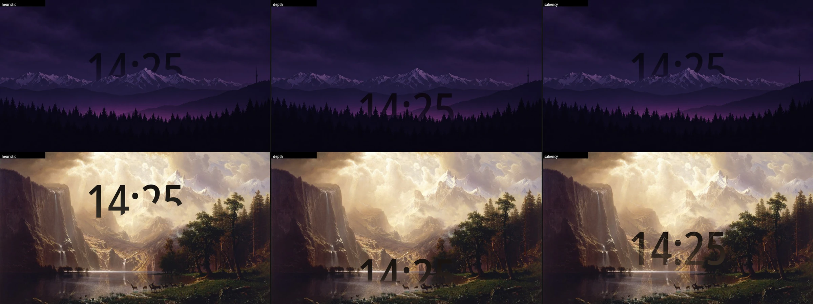

# Research

How the mask approach was chosen. The maintained code is in `src/depth_clock`.

## Three ways to build the mask

Each column is one method, with the clock placed at a fixed spot:

1. **Skyline heuristic** (`make-mask.py`). Finds a brightness jump per column
   and fills everything below it. Its thresholds were tuned by hand for the
   wallpaper in the top row. On the painting below it cuts the digits along
   the clouds.
2. **Relative depth** (Depth Anything V2 Small). Finds the foreground on almost
   every picture. This became the base. One depth cut at a fixed threshold puts
   the clock too low, which the search below fixes.
3. **Subject segmentation** (ISNet). Finds the main object. Works when there is
   one big object, such as a rocket or a person. A landscape has no subject, so
   nothing stands in front of the digits.

## From depth to a good clock

`prototype.py` is the seventh pass of the search. It was tuned on 25 wallpapers
of many kinds: landscapes, cities, line art, flat illustrations, photos.
What each pass fixed:

- Fixed center and one depth cut put the clock low, under the subject. Search
  over several cuts and positions instead.
- Logos, moons and clouds stood in front of the digits. Only parts that touch
  the bottom edge of the picture can stand in front.
- A seam only the model saw cut the digits on a plain texture. The ridge must be
  a visible brightness edge.
- Dark digits vanished on dark skies. The color follows the background behind
  each part of the digits, darker on light skies and lifted on dark ones.
- Clocks landed on logos and people when nothing could stand in front. The
  subject segmentation came back as the map of what not to cover.

About 20 of the 25 came out right. The rest were a busy painting with no calm
spot, a line drawing where the subject fills the frame, and a sun blob under the
digits. Tuning weights further on the same pictures would fit them and nothing
else, so the editor covers the remainder.

The README's sample sheet is a check on pictures the search never saw: public
domain paintings and photos, analyzed by the released code with no changes.
